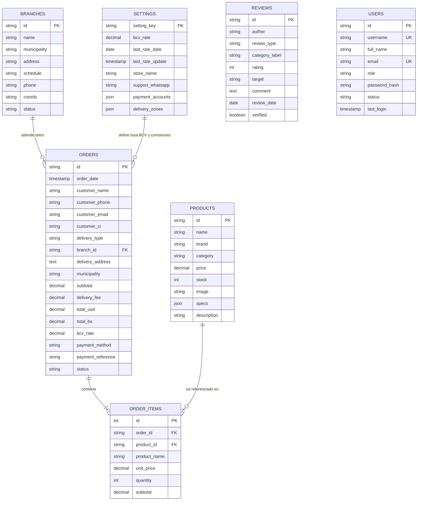

# 🗄️ Diccionario y Estructura de Tablas de la Base de Datos - Nexus Hardware Caracas

Este documento especifica la arquitectura y el esquema relacional de la Base de Datos de **Nexus Hardware Caracas**, tanto para su implementación local en el cliente (**IndexedDB**) como para su definición relacional estándar en **SQL (PostgreSQL / MySQL / SQLite)**.

---

## 📊 Diagrama de Entidad - Relación (ERD)

---

## 📋 Especificación de Tablas (Data Dictionary)

### 1. Tabla `products` (Catálogo de Componentes de Hardware)
Almacena el catálogo de componentes informáticos, procesadores, tarjetas gráficas, memorias, almacenamiento y periféricos.

| Columna | Tipo de Dato | Nulo | Clave | Descripción | Ejemplo |
| :--- | :--- | :---: | :---: | :--- | :--- |
| `id` | `VARCHAR(50)` | No | **PK** | Identificador único del componente | `'cpu-01'`, `'gpu-02'` |
| `name` | `VARCHAR(200)` | No | - | Nombre comercial del producto | `'AMD Ryzen 7 7800X3D'` |
| `brand` | `VARCHAR(100)` | No | - | Marca del fabricante | `'AMD'`, `'NVIDIA'`, `'Corsair'` |
| `category` | `VARCHAR(100)` | No | - | Categoría de hardware | `'Procesadores'`, `'Tarjetas de Video'` |
| `price` | `DECIMAL(10,2)` | No | - | Precio de venta en dólares ($ USD) | `420.00` |
| `stock` | `INTEGER` | No | - | Unidades físicas en inventario | `8` |
| `image` | `TEXT` | Sí | - | URL de la imagen del producto | `'https://images.unsplash.com/...'` |
| `specs` | `JSON` | Sí | - | Atributos técnicos para compatibilidad | `{"socket": "AM5", "tdp": 120}` |
| `description`| `TEXT` | Sí | - | Descripción detallada del componente | `'Procesador gaming con 3D V-Cache'` |

---

### 2. Tabla `orders` (Órdenes de Compra y Transacciones)
Registra los pedidos generados por los clientes, modalidades de despacho y comprobantes de pago.

| Columna | Tipo de Dato | Nulo | Clave | Descripción | Ejemplo |
| :--- | :--- | :---: | :---: | :--- | :--- |
| `id` | `VARCHAR(50)` | No | **PK** | Código único de la orden | `'ORD-7821'` |
| `user_id` | `VARCHAR(50)` | Sí | **FK** | Identificador del usuario propietario (RBAC) | `'usr-client1'` |
| `username` | `VARCHAR(50)` | Sí | - | Nombre de usuario cliente | `'carlos.m'` |
| `invoice_number` | `VARCHAR(50)` | Sí | - | Serie de Factura Digital Fiscal | `'FACT-7821'` |
| `control_number` | `VARCHAR(50)` | Sí | - | Número de Control Fiscal SENIAT | `'00-7821-2026'` |
| `order_date` | `TIMESTAMP` | No | - | Fecha y hora de creación de la compra | `'2026-10-31 14:35:00'` |
| `customer_name` | `VARCHAR(150)` | No | - | Nombre y apellido del comprador | `'Carlos Mendoza'` |
| `customer_phone`| `VARCHAR(50)` | No | - | Teléfono celular de contacto | `'0414-2345678'` |
| `customer_email`| `VARCHAR(150)` | Sí | - | Correo electrónico del cliente | `'carlos.m@gmail.com'` |
| `customer_ci` | `VARCHAR(50)` | Sí | - | Cédula o RIF para facturación | `'V-24.891.203'` |
| `delivery_type`| `VARCHAR(50)` | No | - | Modalidad: `'pickup'` o `'delivery'` | `'pickup'` |
| `branch_id` | `VARCHAR(50)` | Sí | **FK** | Referencia a la sucursal de retiro | `'suc-lasmercedes'` |
| `delivery_address`| `TEXT` | Sí | - | Dirección exacta de entrega delivery | `'Av. Libertador, Edif. Caracas, Piso 6'` |
| `municipality` | `VARCHAR(100)`| Sí | - | Municipio de Caracas | `'Chacao'`, `'Baruta'`, `'Libertador'` |
| `subtotal` | `DECIMAL(10,2)`| No | - | Subtotal en USD de los productos | `545.00` |
| `delivery_fee` | `DECIMAL(10,2)`| No | - | Tarifa de delivery en USD | `3.50` |
| `total_usd` | `DECIMAL(10,2)`| No | - | Monto final a pagar en dólares ($) | `548.50` |
| `total_bs` | `DECIMAL(14,2)`| No | - | Monto equivalente en Bolívares (Bs.) | `487928.95` |
| `bcv_rate` | `DECIMAL(10,2)`| No | - | Tasa oficial del BCV aplicada | `889.57` |
| `payment_method`| `VARCHAR(50)` | No | - | Canal de pago seleccionado | `'pago_movil'`, `'zelle'`, `'binance'` |
| `payment_reference`| `VARCHAR(100)`| Sí | - | Número de confirmación o referencia | `'081294'`, `'ZLL-99410'` |
| `status` | `VARCHAR(50)` | No | - | Estado actual de despacho | `'Confirmado'`, `'En camino'`, `'Entregado'` |

---

### 3. Tabla `order_items` (Detalle de Productos por Orden)
Permite normalizar las compras para asociar múltiples productos a una misma orden.

| Columna | Tipo de Dato | Nulo | Clave | Descripción | Ejemplo |
| :--- | :--- | :---: | :---: | :--- | :--- |
| `id` | `INTEGER` | No | **PK** | Identificador secuencial de línea | `1`, `2` |
| `order_id` | `VARCHAR(50)` | No | **FK** | Referencia al ID de la orden | `'ORD-7821'` |
| `product_id` | `VARCHAR(50)` | No | **FK** | Referencia al ID del producto | `'cpu-01'` |
| `product_name` | `VARCHAR(200)`| No | - | Nombre histórico del componente | `'AMD Ryzen 7 7800X3D'` |
| `unit_price` | `DECIMAL(10,2)`| No | - | Precio unitario al momento de compra | `420.00` |
| `quantity` | `INTEGER` | No | - | Cantidad comprada | `1` |
| `subtotal` | `DECIMAL(10,2)`| No | - | Precio unitario x cantidad | `420.00` |

---

### 4. Tabla `branches` (Sucursales Físicas en Caracas)
Contiene la información de ubicación, contactos y horarios de las 5 tiendas en la Gran Caracas.

| Columna | Tipo de Dato | Nulo | Clave | Descripción | Ejemplo |
| :--- | :--- | :---: | :---: | :--- | :--- |
| `id` | `VARCHAR(50)` | No | **PK** | Código de sucursal | `'suc-altamira'`, `'suc-lasmercedes'` |
| `name` | `VARCHAR(150)` | No | - | Nombre de la sede comercial | `'Sucursal Altamira'` |
| `municipality` | `VARCHAR(100)` | No | - | Municipio de Caracas | `'Chacao'`, `'Baruta'`, `'Libertador'` |
| `address` | `TEXT` | No | - | Dirección física y puntos de referencia | `'Av. Fco. de Miranda, Centro Plaza, Nivel 3'` |
| `schedule` | `VARCHAR(150)` | No | - | Días y rango de atención al público | `'Lunes a Sábado: 9:00 AM - 7:00 PM'` |
| `phone` | `VARCHAR(50)` | No | - | Teléfono local o WhatsApp de la sede | `'+58 212-261-8899'` |
| `coords` | `VARCHAR(50)` | Sí | - | Latitud y Longitud GPS | `'10.4965, -66.8524'` |
| `status` | `VARCHAR(20)` | No | - | Estado de operatividad | `'Abierto'`, `'Cerrado'` |

---

### 5. Tabla `reviews` (Reseñas y Experiencias de Clientes)
Almacena opiniones, calificaciones de 1 a 5 estrellas y testimonios sobre la atención o los componentes.

| Columna | Tipo de Dato | Nulo | Clave | Descripción | Ejemplo |
| :--- | :--- | :---: | :---: | :--- | :--- |
| `id` | `VARCHAR(50)` | No | **PK** | Código identificador de la opinión | `'rev-01'` |
| `author` | `VARCHAR(100)` | No | - | Nombre del usuario que comenta | `'Alejandro R.'` |
| `review_type` | `VARCHAR(50)` | No | - | Clasificación: `'service'` o `'product'` | `'service'` |
| `category_label`| `VARCHAR(100)`| Sí | - | Etiqueta visible del tipo | `'Atención al Cliente'`, `'Producto'` |
| `rating` | `INTEGER` | No | - | Calificación de 1 a 5 estrellas | `5` |
| `target` | `VARCHAR(150)` | No | - | Sucursal o producto calificado | `'Sucursal Altamira'`, `'Ryzen 7 7800X3D'` |
| `comment` | `TEXT` | No | - | Contenido de la reseña | `'Excelente atención en Centro Plaza...'` |
| `review_date` | `DATE` | No | - | Fecha de publicación | `'2026-10-28'` |
| `verified` | `BOOLEAN` | No | - | Indicador de compra verificada | `true` |

---

### 6. Tabla `settings` (Parámetros y Configuraciones Generales)
Gestiona la tasa oficial del BCV del día, cuentas bancarias de la tienda y tarifas de delivery.

| Columna | Tipo de Dato | Nulo | Clave | Descripción | Ejemplo |
| :--- | :--- | :---: | :---: | :--- | :--- |
| `setting_key` | `VARCHAR(100)` | No | **PK** | Clave única de configuración | `'general_config'` |
| `bcv_rate` | `DECIMAL(10,2)`| No | - | Tasa de cambio oficial del día (Bs/$) | `889.57` |
| `last_rate_date`| `DATE` | No | - | Fecha de vigencia de la tasa | `'2026-10-31'` |
| `store_name` | `VARCHAR(150)` | No | - | Nombre legal de la tienda | `'Nexus Hardware Caracas'` |
| `support_whatsapp`| `VARCHAR(50)` | Sí | - | Línea de soporte técnico vía WhatsApp | `'+58 412 555-8899'` |
| `payment_accounts`| `JSON` | Sí | - | Datos bancarios oficiales | Pago Móvil, Zelle, Binance Pay |
| `delivery_zones` | `JSON` | Sí | - | Municipios con costo y tiempo estimado | Chacao ($3), Baruta ($4), etc. |

---

### 7. Tabla `users` (Usuarios y Control de Acceso por Roles - RBAC)
Almacena los usuarios registrados en el sistema, credenciales y privilegios asignados para la protección de la base de datos.

| Columna | Tipo de Dato | Nulo | Clave | Descripción | Ejemplo |
| :--- | :--- | :---: | :---: | :--- | :--- |
| `id` | `VARCHAR(50)` | No | **PK** | Identificador único de usuario | `'usr-admin'`, `'usr-client1'` |
| `username` | `VARCHAR(100)` | No | **UK** | Nombre de usuario para login | `'admin'`, `'carlos.m'` |
| `full_name` | `VARCHAR(150)` | No | - | Nombre y apellido del usuario | `'Administrador Principal'` |
| `email` | `VARCHAR(150)` | No | **UK** | Correo electrónico de contacto | `'admin@nexushardware.com'` |
| `role` | `VARCHAR(50)` | No | - | Rol asignado: `'admin'` o `'cliente'` | `'admin'`, `'cliente'` |
| `password_hash` | `VARCHAR(255)`| No | - | Contraseña o PIN de acceso | `'admin2026'`, `'cliente2026'` |
| `status` | `VARCHAR(20)` | No | - | Estado de la cuenta | `'Activo'`, `'Suspendido'` |
| `last_login` | `TIMESTAMP` | Sí | - | Registro de última sesión activa | `'2026-10-31 12:45:00'` |

---

## 🔒 Modelo de Seguridad y Control de Acceso por Roles (RBAC)

Para garantizar la privacidad y confidencialidad comercial, la información de la base de datos está protegida bajo un esquema estricto de roles:

### 👤 1. Rol: `cliente` (Comprador / Visitante)
* **Permisos Permitidos**:
  * Navegar por el catálogo de componentes.
  * Usar el asistente de compatibilidad (*PC Builder Wizard*).
  * Agregar productos al carrito y procesar compras.
  * Consultar sus pedidos personales y dejar reseñas de atención o producto.
* **Restricciones Estrictas**:
  * ❌ **Base de datos totalmente invisible**: El botón superior **"BD Local"** permanece oculto (`hidden`) en la interfaz.
  * ❌ **Acceso denegado a rutas**: Si intenta acceder a `database` o `admin`, el sistema intercepta la navegación mediante *Route Guards*, emite una alerta de seguridad y solicita autenticación de administrador.
  * ❌ No puede ver inventario global, costos de compra, backups, exportaciones CSV ni datos de otros clientes.

### 🛡️ 2. Rol: `admin` (Administrador)
* **Permisos Exclusivos**:
  * Acceso completo al visor de tablas relacionales de la base de datos (**"BD Local"**).
  * Acceso a la tabla `users` para crear administradores o cambiar roles de clientes en tiempo real.
  * Acceso al **Panel de Control & Reportes** (`admin`) con métricas financieras y stock crítico.
  * Capacidad de editar precios, stocks, estados de pedidos y exportar backups JSON o tablas CSV.
* **Autenticación y Registro**:
  * Formulario de Inicio de Sesión seguro para Administradores o Clientes.
  * Formulario de Registro de Administrador protegido con **Clave Maestra de Seguridad** (`NEXUS-ADMIN-2026`).
  * Persistencia de sesión segura en `localStorage` con panel de perfil y cierre de sesión en 1 clic.

### 📝 Formularios de Registro por Roles de Usuario
* **Registro de Cliente (`cliente`)**:
  * Campos: Nombre completo, usuario, correo electrónico, teléfono/WhatsApp y contraseña.
  * Otorga acceso inmediato a compras en Caracas, seguimiento de pedidos y reseñas verificadas.
* **Registro de Administrador (`admin`)**:
  * Campos: Nombre completo, usuario, correo, teléfono, contraseña y **Código de Autorización Maestro** (`NEXUS-ADMIN-2026`).
  * Desbloquea de forma automática e inmediata el Panel de Administración y el Visor de Base de Datos relacional (`BD Local`).

---

## 💻 Características del Visor de Tablas en la Aplicación

1. **Visualización Tabular Reactiva**: Acceso desde el botón **"BD Local"** en la barra superior. Despliega tablas HTML reales con cabeceras fijas (`sticky`), colores temáticos y badges.
2. **Filtro y Búsqueda Instantánea**: Caja de búsqueda que filtra en tiempo real sobre cualquiera de las columnas de la tabla activa.
3. **Selector Reactivo de Estados de Pedido**: Permite cambiar el estado de cualquier orden (Confirmado, En camino, Entregado, etc.) directamente desde la fila de la tabla sin recargar.
4. **Modal para Crear y Editar Registros**: Permite modificar cualquier dato de un producto, sucursal o reseña, guardando inmediatamente en IndexedDB.
5. **Exportación a CSV**: Descarga individual de cada tabla en formato `.csv` con cabeceras y codificación UTF-8 BOM para apertura directa en Microsoft Excel o Google Sheets.
6. **Alternancia de Vistas**: Botón para cambiar al instante entre **Vista Tabla (HTML)** y **Vista JSON (Código)**.
7. **Script SQL**: Archivo [`database.sql`](file:///c:/Users/Usuario/OneDrive/Desktop/Nexus%20Hardware/database.sql) listo para ejecutar en cualquier gestor de bases de datos relacionales.
